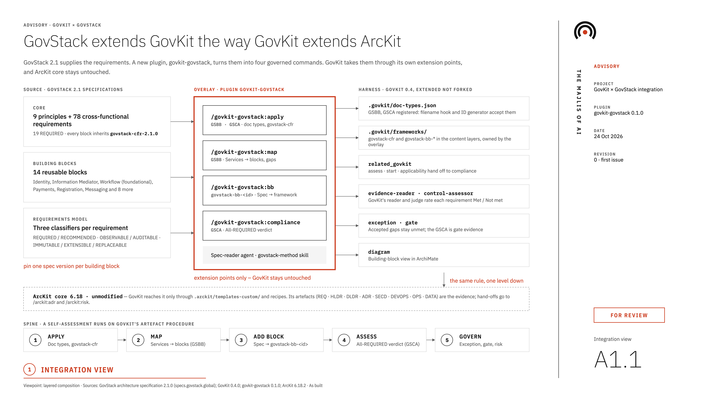

# GovKit overlays

GovKit can be extended by overlays: separate plugins, named `govkit-<name>`, that bring a body of standards into GovKit governance. The first is `govkit-govstack`, for GovStack building blocks. This page explains why overlays are separate plugins, why they're limited the way they are, and why the GovStack overlay judges compliance as it does.

<figure markdown>
  { .diagram loading=lazy }
  <figcaption>Sheet A1.1, integration view. Edit the <a href="../../assets/diagrams/govkit-govstack-integration.drawio">.drawio source</a> in draw.io; the PNG also opens for editing.</figcaption>
</figure>

## Why a separate plugin

GovKit's built-in frameworks are governance frameworks: ISO/IEC 42001, the NIST AI RMF, ISO/IEC 38500. Each is a single file of control intents that slots into GovKit's existing commands. GovStack is a different kind of thing. It is a family of technical specifications with its own vocabulary (building blocks, key functionalities), its own requirement classifiers, its own compliance rule, and fourteen specifications that version independently. Fitting all of that into GovKit core would make every GovKit user carry concepts that only some need, and tie GovKit's releases to GovStack's.

ArcKit faced the same choice with jurisdictions and answered it with overlay plugins such as `arckit-uae` and `arckit-eu`. GovKit uses the same answer one level up. An organisation that adopts GovStack installs the overlay. One that doesn't never sees it.

## Why only extension points

An overlay reaches GovKit exactly the way [GovKit reaches ArcKit](overlay-model.md): only through mechanisms GovKit already supports.

- **Doc types** go into `.govkit/doc-types.json`, the documented way to add artefact types. GovKit's filename hook and ID generator then accept them without knowing the overlay exists.
- **Frameworks** go into GovKit's project or organisation layer, so every GovKit command can resolve them.
- **Commands** live in the overlay's own namespace and follow GovKit's runtime contract and artefact procedure, so their artefacts look and behave like GovKit's.

The rule is deliberately the same in both directions. It means GovKit can change its internals without breaking overlays, and an overlay can release without a GovKit release. GovKit's part of the bargain is small: a schema field (`related_govkit.overlay_commands`) so frameworks can hand off to overlay commands, generic `obligation` and `attributes` fields for source classifiers, and compatibility checks that cover overlays as they cover GovKit.

## Why `apply` copies files

The overlay's frameworks could be read in place from the overlay plugin, but that would need a fourth content layer, and GovKit's zero-dependency hook would have to discover installed plugins. Instead, `/govkit-govstack:apply` copies them into a layer GovKit already reads, marked with a provenance line. This is the same pattern `/govkit:apply` uses for ArcKit template overrides:

- Re-running `apply` after an upgrade refreshes what the overlay owns.
- A file without the provenance line belongs to you and is never overwritten.
- The copy is visible and reviewable in the repository, like every other piece of governance configuration.

## Why the verdict is binary and strict

GovStack decides compliance with one rule: a solution must meet every REQUIRED requirement. GovKit's usual assessments rate maturity on a scale and talk about gaps. Applying a maturity scale to GovStack would invent nuance the standard doesn't have: a solution can't be "mostly compliant" with transport security. So the overlay rates each requirement Met or Not met, and reports RECOMMENDED coverage separately, as GovMarket does.

The same logic explains why an exception doesn't change the verdict. An exception is a governance decision to live with a gap for a while. It isn't evidence that the requirement is met, and treating it as such would make the self-assessment say something GovStack's own process would not.

## Why OBSERVABLE requirements need runtime evidence

GovStack classifies each requirement by how compliance can be verified. An OBSERVABLE requirement can be checked from outside the running system, through API calls, tests or telemetry. An AUDITABLE one needs inspection of internals. A design document that says "we use TLS 1.3" is a claim about an OBSERVABLE property, not a verification of it. GovStack's compliance testing would test the running system, so the self-assessment holds itself to the same standard. That also makes the gap list useful: it shows what to test before GovStack does.

## Why self-assessment only

GovStack runs its own compliance process, with test suites and a marketplace listing. The overlay doesn't replace that and doesn't pretend to. It answers a governance question that comes earlier and more often: is this solution, or this supplier's claim, ready? Labelling every verdict as a self-assessment keeps that distinction clear for a board reading a gate pack.
