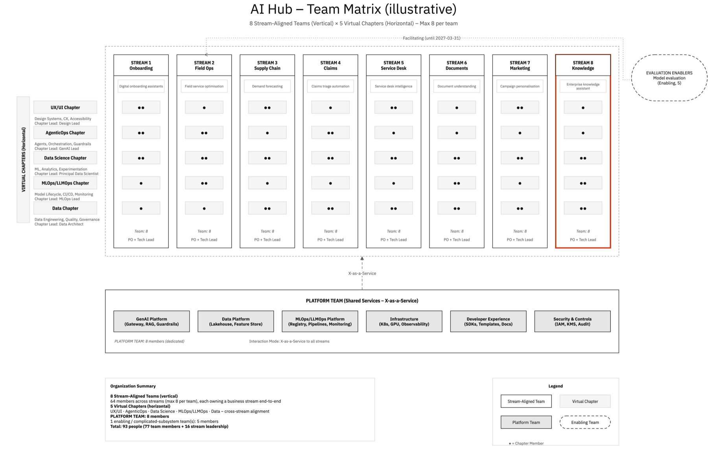

# Your first team matrix

In this tutorial, we will work with a team model directly, using the scripts that the `team-design` skill runs for you. We will validate a model, break a rule and fix it, add a team, and render the result as a draw.io team matrix.

The model describes an AI Innovation Hub: eight stream-aligned teams, five virtual chapters and a platform team.

<figure markdown>
  { .diagram loading=lazy }
  <figcaption>The finished matrix, drawn in the <code>tmofai</code> diagram style. Stream names are illustrative. Your render uses the example's own <code>standard</code> style and names.</figcaption>
</figure>

## Before you start

You need:

- Node.js 22 or later (the version GovKit is tested on)
- git
- optional: [draw.io desktop](https://github.com/jgraph/drawio-desktop/releases), to export an image at the end

## 1. Get the example

Clone GovKit and make a working folder with a copy of the example model:

```bash
git clone https://github.com/majlisofai/govkit.git
cd govkit
mkdir -p ~/team-tutorial
cp examples/teams/ai-innovation-hub.json ~/team-tutorial/hub.json
```

To keep the commands short, set a variable for the scripts folder:

```bash
GK="$PWD/plugins/govkit/scripts"
cd ~/team-tutorial
```

## 2. Validate the model

```bash
node "$GK/validate-team.mjs" hub.json
```

You should see:

```text
OK: 8 stream-aligned, 1 platform, 0 enabling, 0 complicated-subsystem team(s); 5 chapters; 88 people; 0 error(s), 0 warning(s)
```

The model passes every rule.

## 3. Break a rule

Open `hub.json` in your editor. Find the team with `"id": "stream-1"`. Its `members` show how many people from each chapter work in the team:

```json
"members": { "ux": 2, "agenticops": 2, "data-science": 2, "mlops": 1, "data": 1 },
```

Change `"ux": 2` to `"ux": 5`, save, and validate again:

```bash
node "$GK/validate-team.mjs" hub.json
```

```text
FAIL  [team_size] team 'stream-1' has 11 members (allowed 5–8)
INVALID: 8 stream-aligned, 1 platform, 0 enabling, 0 complicated-subsystem team(s); 5 chapters; 91 people; 1 error(s), 0 warning(s)
```

The team is now too big. The rule and its limits are in the model's `rules` block, under `team_size`.

Change `"ux": 5` back to `"ux": 2`.

## 4. Add an enabling team

Stream 2 needs help to adopt model evaluation. We add an enabling team for that. In `teams`, after the platform team, add:

```json
{
  "id": "eval-enablers",
  "type": "enabling",
  "name": "EVALUATION ENABLERS",
  "short": "Model evaluation",
  "mission": "Help streams adopt model evaluation practice",
  "size": 5
}
```

In `interactions`, add how this team works with stream 2:

```json
{ "from": "eval-enablers", "to": "stream-2", "mode": "facilitating", "purpose": "Adopt model evaluation practice" }
```

Validate:

```text
FAIL  [time_boxed] facilitating 'eval-enablers' → 'stream-2' has no "until" date
INVALID: 8 stream-aligned, 1 platform, 1 enabling, 0 complicated-subsystem team(s); 5 chapters; 93 people; 1 error(s), 0 warning(s)
```

An enabling team helps and then steps away, so its interaction needs an end date. Add `"until": "2027-03-31"` to the interaction and validate again:

```text
OK: 8 stream-aligned, 1 platform, 1 enabling, 0 complicated-subsystem team(s); 5 chapters; 93 people; 0 error(s), 0 warning(s)
```

## 5. Mark the focal team

The decision we are documenting is about stream 8. Find the team with `"id": "stream-8"` and add:

```json
"focal": true,
```

The validator does not check this field. The renderer uses it.

## 6. Render the matrix

```bash
node "$GK/render-team-matrix.mjs" hub.json -o hub.drawio
```

```text
hub.drawio: 8 streams × 5 chapters, 1 platform, 1 other team(s), 114 cells
```

Check that the file is valid draw.io:

```bash
node "$GK/validate-drawio.mjs" hub.drawio
```

```text
WARN  page 'Team Matrix': vertices 'tm-legend' and 'tm-legend-dot' overlap
OK: hub.drawio — 1 page(s), 112 vertices, 2 edges, 1 warning(s)
```

The file is valid. The warning is about the legend's "● = Chapter Member" note, which touches the legend box's edge. It does not affect the diagram.

## 7. Look at the result

If you have draw.io desktop, export a PNG:

```bash
bash "$GK/export-drawio.sh" hub.drawio png
```

Open `hub.drawio.png`, or open `hub.drawio` in draw.io desktop or [app.diagrams.net](https://app.diagrams.net). Notice:

- the eight streams as columns, and the five chapters as rows, with one dot per member
- the platform team below, serving every stream X-as-a-Service
- the enabling team on the right, with its facilitating line to stream 2 and the until-date in the label
- stream 8, outlined in the accent colour because it is focal

## What you have done

You have:

- validated a Team Topologies model against its rules
- seen two rules fail, and fixed the model rather than the rule
- added an enabling team with a time-boxed interaction
- rendered the model as an editable draw.io team matrix

In a real project you don't edit the JSON yourself. `/govkit:team-design` builds the model with you, runs these same scripts, and writes a governed TEAM artefact around the matrix.

## Next steps

- [Design teams for a project](../how-to/design-teams.md) with the skill.
- Look up every rule in the [team model reference](../reference/team-model.md).
- Read [about team design](../explanation/team-design.md) to see why streams and chapters are arranged this way.
